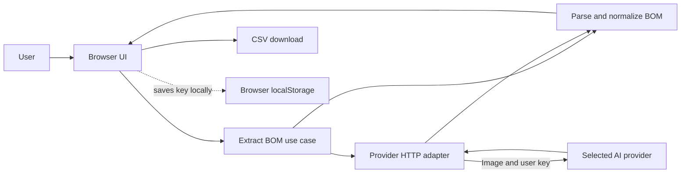

# Architecture

## MVP request flow



The flow stays in the user's browser except for the explicit request to the chosen AI provider. The application host serves static HTML, CSS, and JavaScript only. There is no application server or database in this MVP.

## Layers

- `src/ui`: DOM event wiring, status messages, table editing, and download behavior.
- `src/application`: coordinates a single extraction operation.
- `src/domain`: validates and normalizes model output to a stable BoM item shape.
- `src/infrastructure`: provider request formats and settings persistence.

Provider-specific URLs, headers, models, and payload formats are isolated in one adapter module. The UI does not format provider requests. Provider detection uses recognized prefixes only, never a test call that might disclose the key to multiple providers.

## Growth path

Keep this browser-only MVP for an individual user who supplies and pays for their own provider key. When you need managed credentials, user accounts, team workspaces, audit records, or central rate control, add a backend API boundary:

```text
Browser -> authenticated application API -> provider adapter -> AI provider
                                      -> secret manager
```

The backend should validate file type and size, authenticate and rate-limit users, protect against abuse, and avoid storing drawings unless a documented business requirement calls for retention. The existing UI and domain modules can be retained while provider calls move behind an application API.
